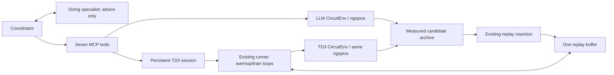

# TwoStage hybrid sizing

One native Antigravity coordinator alternates physics-guided circuit evaluations
with numerical TD3 batches. One circuit-sizing-specialist supplies bottlenecks,
valid absolute changes and short hypotheses. Only the coordinator has MCP access.



Both environments use the same unchanged TwoStage YAML, testbench and measurement
code. Separate environment instances prevent targeted LLM measurements from
changing TD3's active episode. There is one learner and one replay buffer per MCP
process, not one per tool call. State lasts until that process exits.

## Seven tools

| Tool | Purpose |
|---|---|
| get_problem() | Current physical grids/units, targets, reward, remaining budget and TD3 settings/status |
| get_candidates(k=5) | Compact best distinct measured LLM/TD3 designs; request full sizes by design_id and include_parameters=True |
| simulate_design(parameters, hypothesis='') | Validate and measure all 20 physical sizes; archive and insert/defer the experience |
| evaluate_candidate(base_design_id, changes, hypothesis='') | Measure absolute changes to a stored base through the same evaluation path |
| probe_parameters(base_design_id, changes_list, hypothesis='') | Independently test 1-5 modifications of the SAME base; invalid probes use no simulation |
| warmup(n_steps) | Add 1-500 random experiences to existing memory; no gradient updates or clearing |
| train(n_steps) | Continue 1-500 existing TD3 exploration/update steps; preserve networks, optimizers and episode |

Budget includes LLM evaluations, TD3 reset evaluations, random/policy steps and
failed attempts. A whole TD3 batch must fit including its required resets; choose
a smaller batch if rejected. Insertion itself uses zero additional simulations.
No new simulator wrapper, replay buffer, learning equations or Python agent loop.

## How memory is populated

LLM calls store completed source=LLM records, including the initial design. Before
the first measured TD3 reset, insertion is explicitly deferred. The first warmup
or training call establishes a measured state and calls the existing
`inject_llm_candidates`. Later nonterminal LLM evaluations call that same function
immediately; terminal states defer until the next measured reset. One seen-ID set
prevents duplicate insertion. Invalid/incompatible records are reported.

The existing function checks measured specs/reward, physical grids and setup,
converts physical values into float32 absolute actions in env.dict_params order,
and verifies action_refine reconstruction. Each transition branches from TD3's
current measured state to the candidate's normalized measured specs. This relies
on the current static absolute-sizing simulator, not general history-dependent
RL. Insertion leaves live episode/counters/observations and networks unchanged;
time-limit done retains CircuitEnv's existing convention.

TD3Session.run calls td3_runner.warmup_exploration or td3_runner.train directly.
The existing train_policy, ReplayBuffer sampling, action selection, loss and target
updates remain in their original code. A small continuation dictionary lets those
loops stop at a batch boundary and resume next call. The existing TD3 exporter
writes successful random/policy evaluations directly into the shared archive.

## Run from repository root

The following are future model-run commands; validation did not launch Antigravity:

```powershell
# Default guided exploration -> random diversity -> alternating TD3/interventions.
.\.venv\Scripts\python.exe -B llm\run_experiment.py --budget 20

# Standalone LLM evaluation, same native two-role setup, TD3 disabled.
.\.venv\Scripts\python.exe -B llm\run_experiment.py --llm-only --budget 5
```

The launcher reuses the current model/sign-in and writes candidates.jsonl,
session calls.jsonl and one summary.json under ignored llm/runs/. Use --archive
PATH to choose the archive and --td3-config PATH to choose an existing saved
params.json. Default settings come unchanged from the teammate's committed
output_figs/2026-11-05--18-35-18/params.json (noise=.03, batch=64, pi_lr=.0005,
q_lr=.001, seed=123456). w/T in that file are standalone totals; MCP call arguments
specify batch lengths. No hardcoded LLM/random ratio or learning-setting MCP tool.

For direct MCP use, CAD_HYBRID defaults to 1; CAD_HYBRID=0 disables TD3.
CAD_TD3_CONFIG overrides the saved settings path. The coordinator uses native
invoke_subagent/send_message/wait for circuit-sizing-specialist. Specialist tools
are empty, inheritMcp=false, command policy off. Shell, writes and web are denied.
The two existing physics/sizing skills supply qualified circuit knowledge.

Standalone random-only TD3 still uses its original command and numeric flags:

```powershell
.\.venv\Scripts\python.exe -B td3_runner.py --noise_sigma .03 --batch_size 64 --w 100 --T 2000 --pi_lr .0005 --q_lr .001
```

Five ??? defaults remain intentionally unchanged. Standalone loops still finish
whole episodes and can exceed w/T; MCP batches stop at their requested step count.
The MCP wrapper seeds its action space; standalone action-space seeding and its
Unix clean.sh call are pre-existing limitations, preserved for the TD3 owner.
No disk learner checkpoint/resume or cross-process shared memory was added.

## Evaluation and tests

Compare A: random warmup and TD3; B: guided evaluations, added random warmup, then
TD3 without later guidance; C: B plus occasional informed interventions between
train batches. The coordinator controls this sequence, not a second orchestrator.
Fix setup, settings, initialization, action sampling seeds and comparison budgets;
repeat trials. For LLMs evaluate feasible FoM versus elapsed time and CLI tokens;
for TD3 use FoM versus steps/evaluations and separately measured deterministic
final actor quality; for hybrid test learning benefit. Include original LLM cost.
The summary reports actual evaluation/update counts, elapsed time, CLI usage and
measured best ID. One short smoke is not evidence of optimization superiority.

```powershell
.\.venv\Scripts\python.exe -B -m unittest codex_tests.test_persistent_session codex_tests.test_replay_injection codex_tests.test_mcp_server codex_tests.test_multi_agent -v

# Optional real stdio MCP + ngspice + small TD3 updates, zero model calls:
$env:CAD_PERSISTENT_REAL = '1'
.\.venv\Scripts\python.exe -B -m unittest codex_tests.test_persistent_session.TestRealPersistentMCP -v
Remove-Item Env:CAD_PERSISTENT_REAL
```

See [HYBRID_REPORT.md](HYBRID_REPORT.md) for exact results and outside-file changes.
Tests/scratch evidence stay in codex_tests/, which must not be pushed. The obsolete
train_td3.py checkpoint launcher, offline td3_refine workflow/import CLI, three
old specialist roles and their old tests/reports are archived under
codex_tests/llm_history/pre_persistent/. Measured records and older evidence remain
untouched. td3_candidates.py retains the existing exporter, reused by both paths.

## File guide

mcp_server.py exposes seven functions; td3_session.py retains one learner/state;
replay_injection.py is the unchanged tested insertion; candidates.py and
circuit_adapter.py retain history and validation; td3_candidates.py retains the
existing exporter; run_experiment.py launches the native coordinator and summarizes
results. .agents/ contains two roles, two skills and existing MCP registration.
