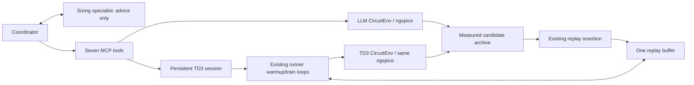

# TwoStage hybrid sizing

One native Antigravity coordinator alternates physics-guided circuit evaluations
with numerical TD3 batches. One circuit-sizing-specialist supplies bottlenecks,
valid absolute changes and short hypotheses. Only the coordinator has MCP access.



Both environments use the same unchanged TwoStage YAML, testbench and measurement
code. Separate environment instances prevent targeted LLM measurements from
changing TD3's active episode. There is one learner and one replay buffer per MCP
process, not one per tool call. State lasts until that process exits.

## Seven tools

| Tool | Purpose |
|---|---|
| get_problem() | Current physical grids/units, targets, reward, remaining budget and TD3 settings/status |
| get_candidates(k=5) | Compact best distinct measured LLM/TD3 designs; request full sizes by design_id and include_parameters=True |
| simulate_design(parameters, hypothesis='') | Validate and measure all 20 physical sizes; archive and insert/defer the experience |
| evaluate_candidate(base_design_id, changes, hypothesis='') | Measure absolute changes to a stored base through the same evaluation path |
| probe_parameters(base_design_id, changes_list, hypothesis='') | Independently test 1-5 modifications of the SAME base; invalid probes use no simulation |
| warmup(n_steps) | Add 1-500 random experiences to existing memory; no gradient updates or clearing |
| train(n_steps) | Continue 1-500 existing TD3 exploration/update steps; preserve networks, optimizers and episode |

Budget includes LLM evaluations, TD3 reset evaluations, random/policy steps and
failed attempts. A whole TD3 batch must fit including its required resets; choose
a smaller batch if rejected. Insertion itself uses zero additional simulations.
No new simulator wrapper, replay buffer, learning equations or Python agent loop.

## How memory is populated

LLM calls store completed source=LLM records, including the initial design. Before
the first measured TD3 reset, insertion is explicitly deferred. The first warmup
or training call establishes a measured state and calls the existing
`inject_llm_candidates`. Later nonterminal LLM evaluations call that same function
immediately; terminal states defer until the next measured reset. One seen-ID set
prevents duplicate insertion. Invalid/incompatible records are reported.

The existing function checks measured specs/reward, physical grids and setup,
converts physical values into float32 absolute actions in env.dict_params order,
and verifies action_refine reconstruction. Each transition branches from TD3's
current measured state to the candidate's normalized measured specs. This relies
on the current static absolute-sizing simulator, not general history-dependent
RL. Insertion leaves live episode/counters/observations and networks unchanged;
time-limit done retains CircuitEnv's existing convention.

TD3Session.run calls td3_runner.warmup_exploration or td3_runner.train directly.
The existing train_policy, ReplayBuffer sampling, action selection, loss and target
updates remain in their original code. A small continuation dictionary lets those
loops stop at a batch boundary and resume next call. The existing TD3 exporter
writes successful random/policy evaluations directly into the shared archive.

## Run from repository root

The following are future model-run commands; validation did not launch Antigravity:

```powershell
# Default: warmup -> large training batches -> occasional LLM interventions.
.\.venv\Scripts\python.exe -B llm\run_experiment.py --budget 2400

# Standalone LLM evaluation, same native two-role setup, TD3 disabled.
.\.venv\Scripts\python.exe -B llm\run_experiment.py --llm-only --llm-evaluations 5 --budget 5
```

Three hybrid strategies use the same existing tools, replay and total-attempt
budget. For example, from the repository root, each command below uses seed
123456 and identical learning settings from the same saved configuration:

```powershell
.\.venv\Scripts\python.exe -B llm\run_experiment.py --strategy interleaved --budget 1200 --warmup-steps 100 --train-steps 900 --llm-evaluations 6 --td3-config output_figs/2026-11-05--18-35-18/params.json
.\.venv\Scripts\python.exe -B llm\run_experiment.py --strategy td3_then_llm --budget 1200 --warmup-steps 100 --train-steps 900 --llm-evaluations 6 --td3-config output_figs/2026-11-05--18-35-18/params.json
.\.venv\Scripts\python.exe -B llm\run_experiment.py --strategy llm_then_td3 --budget 1200 --warmup-steps 100 --train-steps 900 --td3-config output_figs/2026-11-05--18-35-18/params.json
```

`interleaved` warms up TD3 first and continues large training batches around
occasional specialist-guided interventions. `td3_then_llm` reserves budget for
final local refinement of the best measured TD3 policy design, with no later
training. `llm_then_td3` permits no TD3 calls until eight consecutive non-improving
LLM attempts or 30 total LLM attempts in that run; then it warms up and trains
without further LLM evaluations. Strictly greater reward resets the streak;
ties, worse results and failed simulations increment it. Invalid zero-attempt
calls and historical archive records do not count. Probe batch sizes are capped
to avoid crossing the trigger. If budget runs out first, TD3 is not reached.

The strategy is a native coordinator instruction, not a new Python scheduler
or backend phase gate. Actual audited phase order/counts are checked after execution.
Total simulation limits remain backend-enforced, including resets/failures.
Large train batches are capped at 500 and must fit with resets and later phases.
No targets change: rising slew >=30 V/us and UGBW >=100 MHz, plus the other
existing constraints. Equal seeds/settings do not guarantee identical trajectories.

Each run saves its resolved `prompt.txt`; `summary.json` records strategy,
configuration/seed, new phase counts and candidate IDs. Existing ordered archive
records retain source, TD3 warmup/policy phase, LLM hypothesis phase prefixes and
parents; `session_*/calls.jsonl` retains ordered evaluations and training batches.
Together with the final response's switch counts/ID, these reconstruct phase
progress without a second logging system. Each command defaults to a fresh archive.

The launcher reuses the current model/sign-in and writes candidates.jsonl,
session calls.jsonl and one summary.json under ignored llm/runs/. Use --archive
PATH to choose the archive and --td3-config PATH to choose an existing saved
params.json. Default settings come unchanged from the teammate's committed
output_figs/2026-11-05--18-35-18/params.json (noise=.03, batch=64, pi_lr=.0005,
q_lr=.001, seed=123456). w/T in that file are standalone totals; MCP call arguments
specify batch lengths. No learning-setting MCP tool is added.

## Report-ready completion and runtime data

Before launch, a fixed plan is saved in `manifest.json` and supplied to the
coordinator. Defaults are the saved `w` warmup steps, `T-w` policy steps and six
LLM attempts; the default budget is now 2400 to fit that full schedule. Override
counts explicitly with `--warmup-steps`, `--train-steps`, `--llm-evaluations`.
LLM-first retains its conditional 8-consecutive/30-total exploration phase.
Interleaved divides the policy steps into two predefined halves around one LLM
intervention phase. TD3-then-LLM performs all learning before final refinement.
An unaffordable plan is rejected before any CLI launch, accounting for the existing
episode horizon and resets. Unused budget after protocol completion is acceptable.

The coordinator must complete the plan even after finding a feasible/positive
reward design. No minimum-reward stop exists. Plateau in LLM-first changes phase,
not experiment completion. Allowed stops are completion, budget exhaustion or
execution error. `summary.json` reports planned/completed phase steps, errors,
`stop_reason`, `incomplete` and `success`. A CLI `SUCCESS` with unfinished phases
is an unsuccessful, incomplete run. Wrong phase order or extra evaluations also
fail the protocol check. Execution errors and budget stops retain partial progress.

Each new archive record has `metadata.elapsed_s` at measurement export, relative
to the launcher's monotonic start before Antigravity is launched. This includes
LLM latency, simulator work and all intervening TD3 work, rather than summing tool
durations. `metadata.origin` distinguishes LLM, random_warmup and TD3;
`cumulative_simulation_count` includes LLM attempts, TD3 steps and measured resets.
The existing local `simulation_count` remains available. For direct standalone
TD3 exports, the time origin is the archive module's import during runner startup;
there is no LLM offset. Measurements are available before the current step's
gradient update; subsequent elapsed times include that update. The final run
wall time includes completion and final-model response overhead.

For runtime-versus-FoM, select the current run's newly evaluated IDs, sort their
archive records by elapsed_s, filter hard_satisfied=true, and take the running
maximum reward. Before the first feasible measurement, the curve is unavailable,
not zero. Keep source-specific curves as well as the combined curve. This measures
best observed designs, not deterministic final-actor quality. A TD3-only schedule
can use `--strategy interleaved --llm-evaluations 0` with the same warmup/training
counts: no guided simulations are requested, though native coordination still has
LLM runtime/token overhead. The unmodified standalone runner also exports timestamps.

`manifest.json` preserves full TD3 settings/seed, initial design, YAML targets/grids,
model, strategy, budget, horizon, plan and SHA256 identifiers for source, native
agents/skills and configuration files. A frozen `td3_config.json` is passed to the
backend. `prompt.txt`, the CLI result and stderr are retained. Public native
tool events (including schema rejections before Python tools run) are saved in
`public_events.jsonl`; private intermediate text is omitted. Existing calls.jsonl
now records actual tool arguments/results, elapsed times and replay outcomes;
the detailed TD3 batch IDs remain on disk, without enlarging model responses.
Probe outer calls and individual evaluations are both recorded; count only the
individual evaluation tool events for protocol progress. For actual process cost,
count only `simulation_attempt` entries, never add tool counters to those entries.
Short hypotheses and changed values remain linked through parent/candidate IDs;
keep/reject/follow-up decisions must reference measured IDs in the next hypothesis
or saved final response. These are the agent's actual statements, not reconstructed
explanations. Historical records are not rewritten or assigned inferred timestamps.

## Simulation efficiency and hypothetical scaling

Every actual ngspice invocation now appends a `simulation_attempt` entry to the
existing session `calls.jsonl`: global simulation index, simulation ID, initiating
phase (LLM/warmup/train), elapsed time, subprocess wall time and return code.
This includes reset evaluations, failed processes and failed launches. Invalid
parameter calls and replay insertion launch no simulator and add no attempt.
Candidate records retain their source/origin and matching global index. A reset
or an evaluation rejected during later measurement may have no candidate record;
its process attempt is still charged. Do not classify every unmatched ID as a reset.
Direct standalone TD3 writes the same attempt entries beside its saved params.json
as `output_figs/<run_id>/simulation_attempts.jsonl`; its training/warmup behavior is unchanged.

New launcher summaries automatically include `efficiency`: best-so-far feasible
reward versus both elapsed time and simulation index, strict new-best milestones
with candidate IDs/origins, phase attempt totals, and first-hit costs at common
FoM thresholds .1, .3, .5 and .6. Thresholds are reporting points, never stop rules.
No feasible observation means an unavailable curve, not a zero-valued solution.
Unreached thresholds are censored, not successful zero-cost results.

To compare existing launcher run directories offline (no models/training/simulation):

```powershell
.\.venv\Scripts\python.exe -B llm/efficiency.py llm/runs/HYBRID_RUN --baseline llm/runs/TD3_ONLY_RUN --thresholds .1 .3 .5 .6 --output codex_tests/artifacts/efficiency/comparison.json
```

Pass several hybrid directories to compare all three strategies at the same
thresholds. Use a fresh-archive `--llm-evaluations 0` run as the coordinated TD3-only
baseline; coordination overhead remains charged. The lightweight
`summarize_efficiency(records, events, attempts, thresholds)` function also accepts
standalone TD3's archive and attempt log directly. Historical runs lacking exact
timestamps, IDs or complete per-attempt timing report missing coverage; costs are
not reconstructed from rounded figures or assumed average simulator durations.

Simulator execution time is subprocess wall time only, excluding netlist creation,
metric parsing and learning. `td3_non_simulator_batch_s` includes updates, plotting,
replay and setup: it is not a pure gradient-computation timer. Pure LLM inference
and pure TD3 compute time remain unknown because the existing instrumentation
does not isolate them. All of these costs still contribute to elapsed wall time.

When both methods reach the same feasible threshold with complete simulator
timing, matching setup/source identifiers and identical TD3 settings/seed, the
offline comparison can report a hypothetical break-even cost. With N measured
attempts and O = elapsed time to threshold minus measured simulator time:

`c_break_even = (O_hybrid - O_TD3) / (N_TD3 - N_hybrid)` seconds per attempt.

This requires fewer hybrid attempts; if its overhead is already lower, no positive
minimum simulator cost is required. The model assumes each future attempt costs
the same c and non-simulator overhead stays unchanged. Real cost depends on the
design, convergence, hardware and workload; saving one attempt does not imply a
fixed runtime saving. This hypothetical extrapolation is not a measured speedup
or evidence of hybrid superiority. Missing timing, incompatible settings, uncharged
external designs or unreached thresholds produce no break-even claim; matched
repeated trials remain needed.

For direct MCP use, CAD_HYBRID defaults to 1; CAD_HYBRID=0 disables TD3.
CAD_TD3_CONFIG overrides the saved settings path. The coordinator uses native
invoke_subagent/send_message/wait for circuit-sizing-specialist. Specialist tools
are empty, inheritMcp=false, command policy off. Shell, writes and web are denied.
The two existing physics/sizing skills supply qualified circuit knowledge.

Standalone random-only TD3 still uses its original command and numeric flags:

```powershell
.\.venv\Scripts\python.exe -B td3_runner.py --noise_sigma .03 --batch_size 64 --w 100 --T 2000 --pi_lr .0005 --q_lr .001
```

Five ??? defaults remain intentionally unchanged. Standalone loops still finish
whole episodes and can exceed w/T; MCP batches stop at their requested step count.
The MCP wrapper seeds its action space; standalone action-space seeding and its
Unix clean.sh call are pre-existing limitations, preserved for the TD3 owner.
No disk learner checkpoint/resume or cross-process shared memory was added.

## Evaluation and tests

Compare A: random warmup and TD3; B: guided evaluations, added random warmup, then
TD3 without later guidance; C: B plus occasional informed interventions between
train batches. The coordinator controls this sequence, not a second orchestrator.
Fix setup, settings, initialization, action sampling seeds and comparison budgets;
repeat trials. For LLMs evaluate feasible FoM versus elapsed time and CLI tokens;
for TD3 use FoM versus steps/evaluations and separately measured deterministic
final actor quality; for hybrid test learning benefit. Include original LLM cost.
The summary reports actual evaluation/update counts, elapsed time, CLI usage and
measured best ID. One short smoke is not evidence of optimization superiority.

```powershell
.\.venv\Scripts\python.exe -B -m unittest codex_tests.test_persistent_session codex_tests.test_replay_injection codex_tests.test_mcp_server codex_tests.test_multi_agent -v

# Optional real stdio MCP + ngspice + small TD3 updates, zero model calls:
$env:CAD_PERSISTENT_REAL = '1'
.\.venv\Scripts\python.exe -B -m unittest codex_tests.test_persistent_session.TestRealPersistentMCP -v
Remove-Item Env:CAD_PERSISTENT_REAL
```

See [HYBRID_REPORT.md](HYBRID_REPORT.md) for exact results and outside-file changes.
Tests/scratch evidence stay in codex_tests/, which must not be pushed. The obsolete
train_td3.py checkpoint launcher, offline td3_refine workflow/import CLI, three
old specialist roles and their old tests/reports are archived under
codex_tests/llm_history/pre_persistent/. Measured records and older evidence remain
untouched. td3_candidates.py retains the existing exporter, reused by both paths.

## File guide

mcp_server.py exposes seven functions; td3_session.py retains one learner/state;
replay_injection.py is the unchanged tested insertion; candidates.py and
circuit_adapter.py retain history and validation; td3_candidates.py retains the
existing exporter; run_experiment.py launches the native coordinator and summarizes
results. .agents/ contains two roles, two skills and existing MCP registration.
