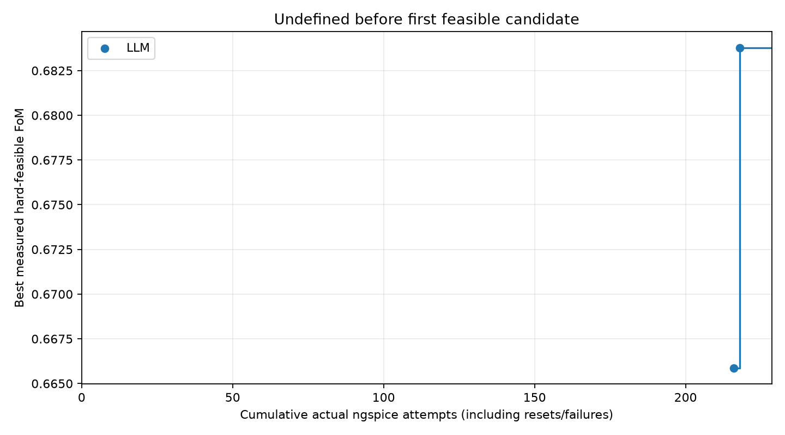
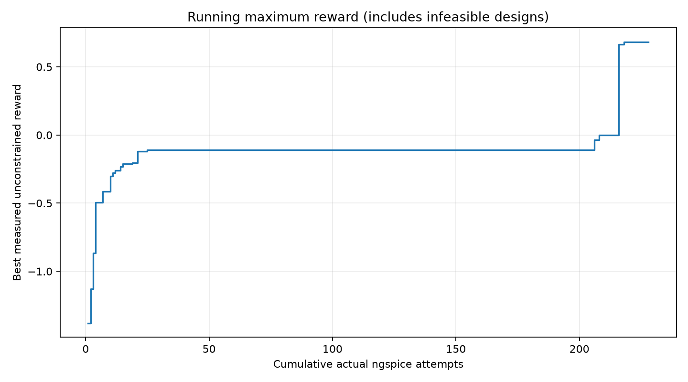

# LLM-led hybrid integration and offline validation

Prepared on `integration/llm-led-validation`, based on current `origin/main`
(`d986776`). The implementation was ported from `origin/feat/llm-led-hybrid`
(`269c3d1`). This report records the implementation and offline validation completed
before publication. No model call, ngspice invocation or new optimization campaign
was performed during integration; subsequent publication adds no experimental work.

## Branch review and integration scope

The feature branch adds `llm_led` and permissive resource-ceiling accounting to the
launcher/MCP server; `llm/deliverables.py` for maximum-reward/Pareto plots and solution
exports; seed 1/2 configurations; documentation; and a protocol regression test.
Persistent TD3, the learner loops and replay-injection implementation were already
present in main and are reused unchanged.

Main separately contains the published `results/llm_led_seed123456/` experiment.
Those files are absent on the feature branch. Applying its whole tree would therefore
delete published evidence. Only these implementation paths were ported:

- `llm/run_experiment.py`
- `llm/mcp_server.py`
- `llm/deliverables.py`
- `llm/configs/td3_seed1.json`, `llm/configs/td3_seed2.json`
- `llm/README.md`
- `codex_tests/test_persistent_session.py`

Targeted fixes also update `llm/experiment.md`, `llm/GEMINI.md`, the coordinator's
stopping instructions, and add `codex_tests/test_llm_led.py`. No other agent or tool
was added. The original circuit, grids, models, constraints, reward, measurements,
TD3 equations/settings and replay-injection semantics remain unchanged. The two
ported seed configurations differ from the existing configuration only in seed.
Published candidate IDs, parents, measurements, summaries, plots and netlists are
unchanged; the other published experiment branches remain untouched.

## Protocol corrections

Previously `llm_led_progress` returned `complete=True` whenever counts were inside
the ceilings—even for an empty run. It now reports live progress as incomplete and
separately records whether resource ceilings are respected. A post-run audit, not a
Python action scheduler, classifies the native agent's outcome:

| Status | Interpretation |
|---|---|
| `completed_optimization` | A hard-feasible best followed by at least eight non-improving candidate evaluations; started probe batches may finish. |
| `voluntary_early_stop` | The CLI returned without a measurement-validated stop or exhausted resources; not treated as completed. |
| `resource_exhaustion` | Actual simulator budget or all configured method ceilings exhausted. |
| `execution_failure` | CLI/process error, failed measured evaluation, ceiling violation or budget overrun. |

Only a strictly better **hard-feasible** reward resets the stagnation streak once
feasibility exists. Infeasible rewards, even positive ones, cannot improve that best.
Failed process attempts remain charged; reset-only measurements are charged but do
not advance the candidate-refinement streak. Resource limits are ceilings rather
than quotas, and their sum need not fit the shared budget: the existing server
checks that each entire requested batch, including required resets, is affordable.

The existing native strategy still chooses LLM exploration/refinement and when TD3
is useful. Guards now explicitly enforce one warmup call of at most 30 steps and
training batches of at most 40 steps, with a reason citing measured candidate IDs.
The total method counts remain limited by the configured ceilings. No learner,
optimizer, replay buffer or active TD3 episode is restarted between batches.

The stopping rule is consistent across the launcher workflow, experiment template,
coordinator and GEMINI instructions. Other fixed/adaptive strategy semantics remain
unchanged. `td3_training_used` and `successful_td3_training_updates` describe actual
updates; `hybrid_training_executed` means both LLM measurements and TD3 updates
occurred, **not** that a causal hybrid-learning advantage was demonstrated. A run
with zero updates does not receive that label.

For backward compatibility, the legacy `best` field remains highest reward without
filtering feasibility. New summaries explicitly add best measured reward, best
hard-feasible FoM/ID/source/phase, first feasible index, actual process count and TD3
updates. They cover the current run's new archive candidates. Reset measurements
are audited/costed but do not enter the selection archive.

The feature's portable `CAD_AGY`/PATH executable resolution and interpreter PATH
prefix are retained. Main's original default model, `gemini-3.8-flash-low`, is
preserved; `--model gemini-3.8-flash-high` explicitly reproduces the published
selection. This avoids silently changing existing strategy defaults.

## Offline reconstruction of the published experiment

The reconstruction reads only the pushed archive, call log, manifest and summary.
Actual cost is counted from `simulation_attempt` entries, never by adding nested
probe/tool counters. All 228 indices are unique and contiguous; all process return
codes are zero. Candidate-source counts and batch update counts are independently
recovered from the corresponding records. Existing assessment code also recomputes
all 213 archived rewards and feasibility flags from their saved specifications,
with no simulator call; all agree with the archive.

| Measurement | Reconstructed result |
|---|---:|
| Actual ngspice attempts | 228 |
| LLM candidate evaluations | 63 |
| TD3 random warmup steps/candidates | 30 |
| TD3 policy steps/candidates | 120 |
| TD3 reset evaluations | 15 |
| Candidate archive rows | 213 |
| Hard-feasible archive candidates | 7 |
| Warmup batches | 1 × 30 steps, 33 attempts |
| Training batches | 4 × 30 steps, 33 attempts each |
| Critic / actor updates | 120 / 60 |
| First feasible simulation | 216 |
| Best feasible simulation | 218 |
| Best hard-feasible FoM | 0.6837858803353272 |
| Unused global budget | 72 of 300 |
| Unused LLM ceiling | 67 of 130 |

First feasible ID: `design_deaacb3b25ff4ee2ac5184d60505279e`, FoM
**0.6658628880580628**, at **724.8448390839985 s**.

Best ID: `design_e8ef3242804b45e7a6e987bd7c0bc53a`, source **LLM**, at
**724.941980749998 s**. Its direct parent is TD3 policy candidate
`design_9d2acc1908c346539a251005a95a1409`, from **global simulation 206** (its
TD3-local `simulation_count` is 164). The parent was infeasible only on UGBW:
89.110478288541 MHz. The only changed parameter is:

```text
wn4: 2.75e-6 m -> 3e-6 m
```

This LLM refinement produced UGBW **100.02680031436238 MHz**, gain
**243.47130000051285 V/V**, PM **61.20603609286859°**, rising slew
**48.01284277229085 V/µs**, noise **0.0039995289 V RMS**, area
**6.891451904761904e-10 m²** and current **0.00024626702 A**. The best candidate is
not relabeled as a TD3 policy output; its parent's origin remains TD3 policy.

The recorded replay reports contain **42 distinct injected LLM candidates** across
initialization/batch boundaries (26 + 8 + 4 + 4; subsequent duplicate insertions are
skipped). With 150 numerical transitions this accounts for the final 192-entry
replay buffer. The remaining 21 LLM candidates arrived without a later update/reset
flush. Replay insertion consumes no simulations. These records establish replay
availability and continued updates, not proof that particular candidates were
sampled or caused the eventual result.

Ten archive candidates after simulation 218 failed to improve its feasible FoM.
That satisfies the eight-non-improvement stopping rule after finishing probe
batches. No budget exhaustion is needed to validate this stop. The original summary
called it `protocol_complete`; the separate review calls it
`completed_optimization / feasible_stagnation`. The original summary is not rewritten.
There are **no numerical discrepancies** in attempts, phase counts, updates, first
feasible index, best ID or best FoM.

The published summary reports total wall time **810.047 s**, simulator subprocess
time **10.914981962025195 s**, and CLI total tokens **371514** (cache reads and
thinking remain separately reported fields). Those are historical observations,
not timings or costs from this integration.

## Corrected plots and preserved exports



The curve is undefined before simulation 216, rather than zero. Its only new-best
points are 216 and 218, both source LLM. Global process indices include every reset
and would include failures. Generic plotting also distinguishes TD3 warmup and TD3
policy improvement markers through each candidate's source and phase.



The retained `max_reward.png` is now accurately labeled **unconstrained reward**
and also uses actual cumulative process indices. Unlike its predecessor, its x-axis
does not compress 228 attempts into 213 archive positions. In this particular run
the final best reward is also hard-feasible; that coincidence is not assumed by
selection code or tests.

The existing area/current Pareto algorithm is reused. The regenerated
[Pareto plot](llm_led_validation/pareto.png) and
[Solutions CSV](llm_led_validation/Solutions/solutions.csv) retain the two measured
Pareto designs and copy their available published netlists. No replacement netlists
are generated and ngspice is not called. Flat published call logs and native nested
session logs are both supported.

Offline reading preserves the historical problem ID. The saved YAML's LF hash is
`960742d9b875…`; this Windows checkout can have different raw CRLF hashes for the
same YAML values. Filtering the archive only by the current checkout's raw-byte
setup ID would wrongly discard the saved run. Regeneration instead uses its saved
setup ID and evaluated IDs; no historical ID or hash is rewritten.

## Tests and reproduction

Final validation: **56 tests ran in 54.056 seconds: 55 passed, one optional real-MCP
smoke skipped**. `CAD_PERSISTENT_REAL=0` was set; all simulator calls in the executed
suites are mocked, and no Antigravity model call occurs. Tests cover:

- persistent actor/critic/target network, optimizer and replay object identities;
- continued weight updates and correct update counters across batches;
- existing LLM replay insertion without extra simulator calls or TD3 episode changes;
- reset/failure cost and shared-budget rejection before an unaffordable batch;
- TD3-generated refinement bases and preserved source/parent IDs;
- all existing fixed/adaptive strategies and launcher error handling;
- honest empty/early/stagnation/resource/error outcomes and bounded TD3 calls;
- missing or duplicate process indices cannot validate a stagnation stop;
- positive infeasible reward versus hard-feasible selection and missing pre-feasibility values;
- published 206→218 ancestry, all reconstructed counts, seed-only config differences;
- offline plot/export creation and byte-for-byte preservation of the source run.

The [measurement summary](llm_led_validation/measurement_summary.json) and
[independent verification](llm_led_validation/verification.json) are separate from
the immutable published summary. Reproduction commands for offline regeneration,
tests, and future separately authorized seed/model runs are maintained in
[the LLM README](../README.md#llm-led-hybrid-mode-and-offline-verification).

## Scientific limitations

This is useful measured cooperation: numerical policy search supplied an
infeasible base and LLM refinement repaired it. It does not show superiority over
independent LLM-only or TD3-only methods, or establish which replay items influenced
which gradient updates. There is one run/seed, no matched independent baseline and
no final deterministic-actor evaluation. Model invocation is stochastic; seeds do
not guarantee an identical LLM trajectory.

The nominal champion has only **0.02680031436238 MHz** UGBW reserve (about 0.0268%)
and **1.20603609286859°** phase-margin reserve. Feasibility is for this testbench,
not PVT/mismatch robustness. The original CLI narrative swaps the bias-reference
and output-sink device roles in its final table and asserts operating-point causes
without direct measurements; those prose claims are not promoted to verified
physics. The measured parameter map and ancestry remain untouched.

Offline files cannot prove in-memory object persistence retrospectively; source
review and mocked continuation tests establish that property of the integrated
implementation. Failed-attempt and no-update cases are regression-tested but did
not occur in the published successful run. The optional live simulator smoke was
deliberately not run. No new scientific performance claim follows from integration.
