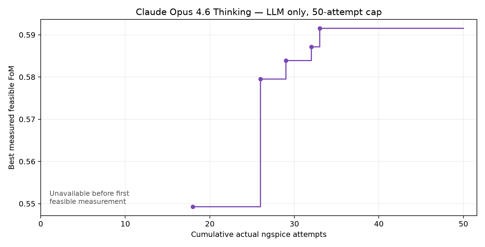
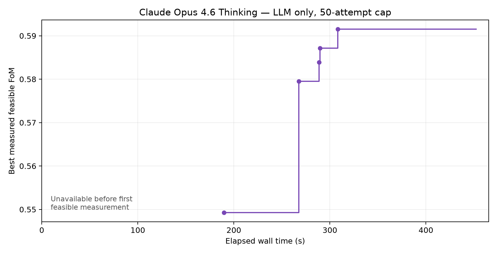

# Claude Opus 4.6 Thinking: one model-only CAD experiment

> Published evidence is curated from the completed local run. Raw CLI/session logs and earlier run directories remain local and are identified as local artifacts below. Personal filesystem paths are redacted; measurements and source hashes are unchanged.

Claude found a feasible circuit at simulation **18** and reached best feasible FoM **0.5915045381032986** at simulation **33**. The existing LLM-only protocol completed **50/50 actual ngspice attempts**, with TD3 disabled. This is promising numerical performance, but the model repeatedly confused device roles and wasted one simulation on an exact repeat. Available Gemini experiments use different workflows or starting designs; this run does **not** establish a causal model improvement.

## Configuration and implementation

Run: `llm_only_9c1ype44`. Started 7 November 2026, 11:33:53 Europe/Brussels (10:33:53 UTC). Repository revision `d467f614447780de950760b48af2b1a733c3a213` plus the pre-existing local implementation recorded by SHA256 in [manifest.json](manifest.json).

The installed `../.tools/antigravity/agy.exe models` returned:

```text
gemini-3.8-flash-high       Gemini 3.8 Flash (High)
gemini-3.8-flash-medium     Gemini 3.8 Flash (Medium)
gemini-3.8-flash-low        Gemini 3.8 Flash (Low)
claude-sonnet-4-6          Claude Sonnet 4.6 (Thinking)
claude-opus-4-6-thinking    Claude Opus 4.6 (Thinking)
gpt-oss-120b-medium        GPT-OSS 120B (Medium)
```

The exact selected identifier was **`claude-opus-4-6-thinking`**. The public CLI initialization event confirms that model. Both unchanged native agent definitions use `model: inherit`, so the coordinator and circuit-sizing specialist receive the same selection. No effort override was supplied; the CLI's defaults for that Thinking model apply. Public logs do not independently expose the specialist's resolved model or separate token billing.

Only four source lines were added/changed in `llm/run_experiment.py`: add `--model` with the existing `gemini-3.8-flash-low` default, pass `args.model` to Antigravity, and record it in the manifest and summary. No prompts, skills, tool definitions, candidate/replay selection, TD3 settings, reward, environment, netlists, device models or measurements were changed for this experiment. The repository already contained extensive uncommitted work before this task; those changes were preserved. No commit or push was made.

Exactly one optimization command was launched, from the repository root:

```powershell
.\.venv\Scripts\python.exe -B llm/run_experiment.py --model claude-opus-4-6-thinking --llm-only --llm-evaluations 50 --budget 50
```

No `--archive` was supplied: the launcher created a fresh archive with no imported candidates. The unchanged `initial_design.json` was measured first. The existing LLM-only prompt, native role instructions, sizing grids, targets, reward and ngspice path were used. Existing backend accounting charged every actual simulator attempt, including failures had any occurred. The mandatory schedule continued after feasibility, with the unchanged 15-minute CLI timeout. There were no automatic retries, extra campaigns, budget increases or fallback models.

All manifest-identified files still match their launch hashes after completion; see [report_audit.json](report_audit.json). This verifies stability during the run, not equivalence of every historical experiment's agent instructions.

## Preflight tests

Before launching, the existing suite was run:

```powershell
.\.venv\Scripts\python.exe -B -m unittest codex_tests.test_persistent_session codex_tests.test_replay_injection codex_tests.test_mcp_server codex_tests.test_multi_agent codex_tests.test_efficiency -v
```

**43 tests ran in 32.826 seconds: 42 passed, one optional real-persistent-MCP test skipped.** Coverage includes failed-attempt budgeting, no-op rejection, LLM-only operation, schedule completion after feasibility, native role restrictions, replay behavior and efficiency accounting. `run_experiment.py --help` also confirmed the new argument. No new optimization logic or implementation-mirroring tests were introduced. Full output: [preflight_tests.txt](preflight_tests.txt).

The initial sandboxed model query could not access normal CLI state; the normal-access query succeeded. Likewise, Python dependency ACLs required running the tests with normal access. Neither was an optimization launch or retry.

## Measured outcome

| Item | Result |
|---|---:|
| Actual ngspice process attempts | 50 |
| Complete contiguous attempt log | indices 1–50 |
| Simulator return code zero | 50 |
| Failed simulator attempts | 0 |
| Archived measurements | 50, including one repeated parameter vector |
| Feasible measurements | 20 |
| TD3 steps / critic updates | 0 / 0 |
| Protocol / CLI status | complete / SUCCESS |
| Stop reason | protocol_complete, all 50 attempts consumed |
| Total wall time | 452.254 s (7 min 32.254 s) |
| Simulator subprocess time | 9.611516400007531 s |

The remaining wall time includes model/tool latency, coordination, startup, parsing and completion overhead; it is not a separately measured inference time. Best FoM is the existing reward of a **hard-feasible** measured design. A small positive reward alone does not certify feasibility: several recorded infeasible candidates have positive reward.

First feasible: **`design_9042f29b8f9d48618c92140637aeed9a`**, simulation **18**, elapsed **189.61707570008002 s**, FoM **0.5492808766544028**. Its full sizes and measurements are in [first_feasible_design.json](first_feasible_design.json).

Best: **`design_267b826c23e34353b23607dfb2e051a5`**, simulation **33**, elapsed **308.30018740007654 s**, FoM **0.5915045381032986**, all five hard constraints satisfied. No later probe improved it. Exact archive record: [best_design.json](best_design.json).

| Specification | First feasible, simulation 18 | Best, simulation 33 | Existing hard requirement |
|---|---:|---:|---|
| Gain (V/V) | 260.57182000078654 | 285.84710000104775 | ≥200 |
| Integrated noise (V RMS) | 0.0048916258 | 0.0058496409 | ≤0.03 |
| Phase margin (deg) | 61.76208369273651 | 64.9666806123915 | ≥60 |
| Rising slew (V/µs) | 45.04160727671572 | 47.29779823783112 | ≥30 |
| UGBW (Hz) | 113847395.3390819 | 100211122.16776088 | ≥100000000 |
| Area (m²) | 8.508077619047619e-10 | 8.425510119047618e-10 | reward objective |
| Current (A) | 0.00027271837 | 0.00025232606 | reward objective |

The best bandwidth margin is only **0.21112216776088 MHz (0.2111%)**. Feasibility covers this nominal testbench; it does not demonstrate PVT, mismatch or manufacturing robustness. Area/current reference values in the reward are not additional hard feasibility limits.

All 20 best sizing parameters are below. Widths and lengths are per-device controls; multiplicities for the input pair and first-stage mirror each control both paired instances.

| Verified device role | Multiplicity control | Width control (m) | Length control (m) |
|---|---|---|---|
| NMOS input differential pair | `mn1=12` | `wn1=1.75e-6` | `ln1=1.35e-7` |
| PMOS first-stage mirror load | `mp1=8` | `wp1=1.5e-6` | `lp1=1.35e-7` |
| NMOS diode-connected bias reference | `mn3=15` | `wn3=1.25e-6` | `ln3=9e-8` |
| NMOS input-tail mirror output | `mn4=25` | `wn4=2.5e-6` | `ln4=9e-8` |
| PMOS second-stage common-source amplifier | `mp3=16` | `wp3=2e-6` | `lp3=1.35e-7` |
| NMOS second-stage sink/mirror output | `mn5=17` | `wn5=2.5e-7` | `ln5=4.5e-8` |

Compensation: **`cap=1e-12 F`, `res=6000 Ω`**. Relative to the supplied initial circuit, only `cap`, `mn4`, `wn4`, `mp3`, `mn1` and `wn5` changed in this best design.

## Feasible FoM progression





Curves use the existing `summarize_efficiency` output and actual measurement timestamps/attempt indices. Before the first feasible observation the curve is unavailable, not zero. The final plateau extends to experiment completion. Figures were generated offline with Matplotlib and visually checked.

| Simulation | Elapsed s | New best feasible FoM |
|---:|---:|---:|
| 1–17 | — | unavailable |
| 18 | 189.61707570008002 | 0.5492808766544028 |
| 26 | 267.56406980007887 | 0.5795342734591495 |
| 29 | 288.8223707000725 | 0.58386439965744 |
| 32 | 289.76589699997567 | 0.5871716988807469 |
| 33–50 | 308.30018740007654 onward | 0.5915045381032986 |

Feasible thresholds 0.1, 0.3 and 0.5 were first reached at simulation 18; 0.6 was not reached within 50 attempts. Exact curves and threshold records: [efficiency_report.json](efficiency_report.json). Full measurements, parents, parameters and original hypotheses: [measurements.csv](measurements.csv).

## Actual sizing decisions and reasoning review

These summaries distinguish recorded hypotheses from measured effects. They do not infer operating points, saturation, poles or transistor gm from the scalar specification outputs.

| Attempts | Recorded approach | Measured result and assessment |
|---|---|---|
| 1 | Measure unchanged initial circuit | Reward −1.380930440660967; gain 188.355 V/V, SR 6.896 V/µs, UGBW 14.701 MHz failed; PM 103.458° left compensation margin. |
| 2–6 | Independent cap, PMOS-load and tail-size probes | Reducing Cc improved speed while reducing PM. `mp1=16` and `wp1=3µm`, described as boosting input gm, collapsed gain to about 33 V/V. `mn4=22` raised gain to 274.064 V/V and UGBW to 43.632 MHz. Controlled probes made the failed load hypothesis easy to reject. |
| 7–10 | Reduce Cc on the improved tail-current base | At 0.8 pF, SR 35.55 V/µs and PM 63.31° passed, but UGBW remained 50.04 MHz. At 0.5 pF, PM failed. The trade-off direction was physically sensible; cap reduction alone was insufficient. |
| 11–19 | Shorten `lp1`, increase tail/sink multiplicity, test tail width and resistor | `lp1=90nm` reduced gain to 80.02; 45nm produced gain 0.187 and no unity-gain crossing. `mn4=25`, then `wn4=2.5µm` with Cc 1pF produced first feasibility at 18. `res=4kΩ` on its tested base reduced UGBW to 44.69 MHz. |
| 20–28 | Explore feasible-base compensation, bias and second-stage sizes | Cc 1.2pF increased PM but lowered reward to 0.5172. `res=7kΩ` violated PM (56.53°). `mn3=12` increased total current to 330.190µA, UGBW to 148.16MHz and violated PM, contrary to its stated current-reduction rationale. `mp3=14/15` lost bandwidth; 16 retained feasibility and raised FoM to 0.579534. |
| 29–33 | Reuse the `mp3=16` base; test input multiplicity, bias-reference size and sink width | `mn1=12` and `wn5=250nm` separately improved FoM. `wn3=1µm` and `mn3=12` increased current and violated PM. Combining the two measured beneficial changes produced the best at 33. This was a useful measurement-led combination. |
| 34–41 | Seek bandwidth headroom through mirror-load sizing and combine changes | `mp1=7` raised UGBW to 107.83MHz but also current to 269.519µA, reducing FoM. Combining it with narrower `wp3` still failed bandwidth (96.47MHz). Other combinations were feasible but worse. One proposed `mn1=12` change was already the base value and was rejected without simulation. |
| 42–50 | Fine local probes and final combinations | No improvement over simulation 33. `mn1=13/14` traded small FoM losses for modest bandwidth margin. More tail width raised speed/current; reducing it on another base lost bandwidth. Simulation 50 repeated simulation 42 exactly, returning identical measured specs and FoM. |

The most consequential physical reasoning errors persisted in the final answer:

- It labels `mp1/wp1/lp1` a PMOS differential pair and `mn1/wn1/ln1` an NMOS load. The verified topology has an **NMOS input pair** and a **PMOS mirror load**. The attempt 11–14 hypothesis explicitly calls `lp1` the differential-pair channel length. This is a topology error, not merely an unsuccessful sensitivity prediction.
- It calls `mn3` the second-stage current source/load. It is the diode-connected reference shared by the input-tail and output-sink mirrors. Reducing its size can increase both mirrored biases. The measured rise in total current for `mn3=12`/`wn3=1µm` contradicts the proposed current reduction.
- It describes `mn5` as a generic bias transistor; its specific role is the second-stage sink. It also initially uses measured total current as an approximate tail current in a slew estimate. Total supply current is not a measured branch current.
- It attributes collapsed gain to a saturated differential-pair/load condition and says a resistor result proves the zero was already well placed. No DC operating-point, pole or zero measurements were exposed; these mechanisms remain unverified. A failed resistor probe does not contradict circuit theory or establish an optimum.
- Claims that the local region is optimal are unsupported by 50 samples. The saved best's tight bandwidth margin does not establish practical robustness; even the model's preferred 2.4% margin alternative was not PVT-tested.

No instructions or physics skills were edited to repair these problems during the run. They are findings of this model-only experiment.

## Tool efficiency and usage

The backend audit has one `simulate_design`, 50 `evaluate_candidate` entries (49 actual measurements plus one rejected no-op), 12 outer `probe_parameters` calls, one `get_problem` and five `get_candidates` calls. Outer probe entries duplicate their inner evaluation accounting and must not be added to simulator-attempt totals. One outer batch is marked unsuccessful because of the no-op while its other two valid probes simulated successfully; this is not a failed ngspice process.

There is **one exact repeated measured design**: simulation 50 equals simulation 42 (`design_bacbfff79fea43b4b06ba3849b0860e7` → `design_182a02c885cf42c08ed7b338aad40f19`). This consumed 1/50 of the budget. Reusing the same parameter value on a different base elsewhere is not counted as a duplicate.

The final public stream contains 32 coordinator response steps, two specialist invocation steps, two `send_message` calls and three `manage_task(Action=list)` calls. The coordinator struggled to receive/recognize the first specialist reply, checked task status repeatedly, and invoked the specialist again with similar initial context. The narrative also repeatedly says it will read/re-read the skills, without public file-read tool evidence. A full initial candidate retrieval repeated data already available from the supplied sizes and simulation result. These are observable coordination/data-use inefficiencies; private specialist replies are not independently available, so its exact advice and responsibility for errors cannot be reconstructed beyond the coordinator's attribution.

No public error-state steps or simulator failures were found. The one backend no-op and its outer batch failure are retained in [report_audit.json](report_audit.json). The CLI's broad initialization tool inventory is not proof those tools were used; the actual public events show the calls above.

Original CLI usage fields:

```json
{"input_tokens":89655,"output_tokens":18527,"thinking_tokens":0,"cache_read_tokens":938079,"total_tokens":108182}
```

The zero `thinking_tokens` field does not prove the Thinking model performed no reasoning; it is what this CLI reports. Cache-read usage is separately reported and is not silently added to or subtracted from `total_tokens`. No dollar cost, isolated inference time or complete independent specialist token total is available. Original output and public events: cli_output.json (local artifact: `cli_output.json`), public_events.jsonl (local artifact: `public_events.jsonl`).

## Comparison with earlier Gemini Flash experiments

All rows below selected `gemini-3.8-flash-low` except the new Claude row. These are historical context, not matched model controls. Counts include resets/failures where recorded; a six-attempt refinement excludes the upstream cost of obtaining its saved feasible base.

| Run | Workflow / starting information | Cap / actual attempts | Best measured feasible FoM | Wall s | CLI total tokens |
|---|---|---:|---:|---:|---:|
| This Claude run | Fresh LLM-only, unchanged initial circuit | 50 / 50 | 0.5915045381032986 | 452.254 | 108182 |
| Gemini fixed hybrid A (local artifact: `../hybrid_wk1z_tx5/summary.json`) | Initial measurement + 200 warmup + 800 TD3 steps + 6 refinements | 1200 / 1107 | 0.5171037405236218 | 420.362 | 168950 |
| Gemini adaptive hybrid B (local artifact: `../hybrid_umdetm8y/report.md`) | 200 warmup + 32 LLM attempts + 100 TD3 steps | 1200 / 362 | 0.4187645108893522 | 325.259 | 165292 |
| Gemini earlier hybrid (local artifact: `../hybrid_cjxzr3bp/summary.json`) | 50 warmup + 200 TD3 steps + LLM guidance | 1200 / 287 | 0.3988751907939848 | 300.861 | 206844 |
| Gemini substantial hybrid (local artifact: `../meaningful_hybrid_20261105_213240/summary.json`) | Guided/replay initialization, 192 new random steps, 800 policy steps; different saved TD3 settings | 1200 / 1103 | 0.5988832864287164 | 421.3005945000332 | 203163 |
| Gemini local follow-up (local artifact: `../local_followup_20261105_221225/cli_summary.json`) | Already feasible saved TD3 base, FoM 0.5988832864287164 | 6 new / 6 | 0.6364799496405749 | 71.47428530012257 | 131840 |
| Gemini E05 (local artifact: `../e05_20261106_003615/summary.json`) | Same strong saved TD3 base; explicit token-efficient local prompt | 6 new / 6 | 0.6261133775212937 | 50.37672180007212 | 70676 |

The fixed A and adaptive B manifests have the same nominal initial design and targets/grids as this run. B's recorded source hashes match current sources except the launcher; A also differs in coordinator instructions, `GEMINI.md`, experiment prompt and MCP server. Both use hybrid allocations and many more simulator attempts. B remains formally incomplete/early-exit despite the CLI returning SUCCESS; its available budget was not exhausted. These differences preclude a causal model comparison.

Claude exceeded some historical hybrid scores with fewer attempts, but took longer wall time than those listed hybrid runs on this fast simulator. Other Gemini runs reached a higher score, and local follow-ups benefited from a strong pre-existing circuit. Neither observation isolates a model effect. Token totals also use separate cache fields and different contexts; they do not establish a cost advantage.

Claude showed useful compensation/current trade-off exploration and followed measured improvements into a feasible circuit from scratch. It does **not clearly appear more physically informed** than Gemini: it repeatedly contradicted the same verified topology guidance that was already provided, made unverified operating-point claims and repeated a design. The outcome supports further controlled testing, not switching the default now.

## Recommended next controlled experiment

Keep the Gemini default. Next, run **one matched Gemini Flash LLM-only baseline** with `--model gemini-3.8-flash-low --llm-only --llm-evaluations 50 --budget 50`, a fresh archive, the same nominal initial circuit and byte-identical prompt/agent/skills/backend configuration used here. Preserve source hashes and use the same machine and logging. Compare first-feasibility attempt, feasible best-so-far FoM at equal attempt counts, wall time, reported usage, topology errors, no-ops and duplicates. Do not transfer this run's best circuit or reasoning into that baseline.

That is a recommendation only; no baseline or additional campaign was launched. If the matched result warrants it, separately authorize repeated paired trials under the same 50-attempt cap to assess model variability. This single Claude run is insufficient to recommend a causal model upgrade.

## Evidence

[manifest.json](manifest.json), prompt.txt (local artifact: `prompt.txt`), summary.json (local artifact: `summary.json`), candidates.jsonl (local artifact: `candidates.jsonl`), session attempt/tool log (local artifact: `session_6f0zhzp1/calls.jsonl`), [measurements.csv](measurements.csv), [best_design.json](best_design.json), [first_feasible_design.json](first_feasible_design.json), [efficiency_report.json](efficiency_report.json), [report_audit.json](report_audit.json), [preflight_tests.txt](preflight_tests.txt). Generated report artifacts are offline only. Existing logging and efficiency summarization were reused; the reporting script starts no model, learner or simulator.
