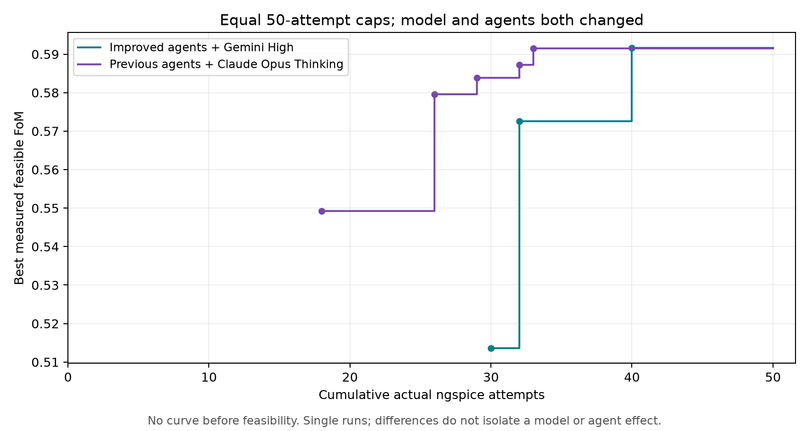
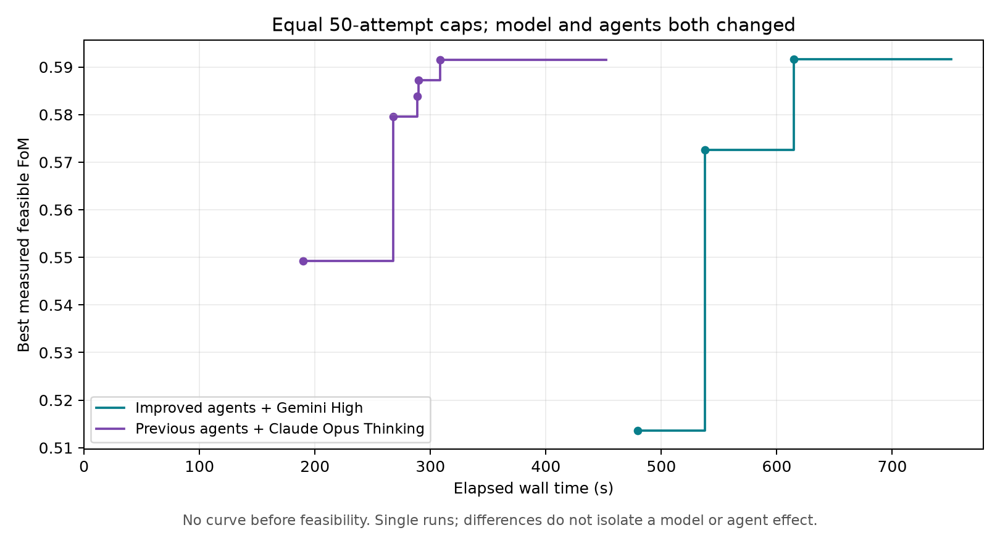

# Improved agents with Gemini High: one 50-attempt CAD experiment

> Curated publication of the completed local experiment. Raw CLI/session logs remain local and are labeled below. Personal filesystem paths are redacted; measurements and source hashes are unchanged. The [Claude reference report](../claude_opus46/report.md) is included in this branch.

The campaign completed **50 actual ngspice attempts**, found its first feasible circuit at **simulation 30**, and achieved best feasible FoM **0.5916926799645618** at **simulation 40**. It used **750.815 seconds** and **219,221 reported CLI total tokens**, with cache reads reported separately. There were **no repeated measured vectors, no no-op requests and no cache hits**.

Compared with the saved Claude run, the final FoM is nearly identical, feasibility came later, and runtime/token overhead increased. Device-role labeling improved in the observable response, and redundant specialist creation/status polling disappeared. However, frequent specialist messages, repeated full candidate retrieval, unsupported operating-point claims and unit/constraint errors remain. **This run does not demonstrate a better practical efficiency trade-off.** Both model and agent instructions changed; no causal model or instruction effect can be isolated from these two single runs.

## Previous failures and targeted changes

The Claude reference is `llm_only_9c1ype44`; its original report, measurements and audit were reviewed along with the published `llm/reports/claude_opus46` evidence in the personal GitHub checkout. The active experiment working copy remains `cad-git`. Historical run records were not edited.

The evidenced weaknesses were: confusing the NMOS input pair with the PMOS mirror load; treating the shared bias reference as an output-stage load; one exact repeat at simulation 50 of simulation 42; one rejected no-op; repeated specialist invocation/status checks; redundant data retrieval; and unsupported claims of saturation, pole locations or optimality.

| Changed files | Targeted modification |
|---|---|
| `llm/.agents/skills/opamp-physics/SKILL.md` | Silent device-role check before hypotheses; explicitly distinguish input-pair and load controls, shared `mn3` bias relationship, and total versus tail current. |
| `llm/.agents/skills/sizing-experiments/SKILL.md` | Distinguish major-violation exploration from near-feasible refinement; permit justified coupling; combine measured beneficial changes; keep a compact changes/outcome ledger and recognize zero-attempt cached results. |
| `llm/.agents/agents/coordinator.md` | Check advice against topology, retain one specialist identity/advice, avoid reinvocation/status polling, reuse already supplied sizes and keep short measured context. |
| `llm/.agents/agents/circuit-sizing-specialist.md` | Verify topology silently; return short actionable changes/trade-offs; allow justified coupled exploration and smaller refinement without a verbose mandatory template. |
| `llm/GEMINI.md`, `llm/experiment.md` | Align the experiment instructions with those policies; cached/no-op calls do not satisfy the fixed attempt schedule. |
| `llm/circuit_adapter.py` | Validate and map physical values to sizing-grid indices; fingerprint simulator/circuit sources, PVT, grids, targets and simulator override for safe measured-result reuse. Assessment/reward methods are unchanged. |
| `llm/candidates.py` | Add a lookup of completed, non-fixture measurements matching both setup fingerprint and grid vector in the existing JSONL archive. No database or separate cache subsystem. |
| `llm/mcp_server.py` | Return the existing measured ID/specs/FoM on duplicates without invoking ngspice or replay flush; reject grid-equivalent no-ops; preserve original parents and record requested parents separately; count only distinct new vectors in a probe batch's schedule guard. |
| `codex_tests/test_candidate_reuse.py`, `codex_tests/test_mcp_server.py` | Six focused reuse/accounting tests; adapt two existing tests to cached reuse at an exhausted budget and distinct measurement ranking. |

No architecture rewrite, added agents/tools, surrogate model or optimizer was introduced. All seven MCP tool names and argument schemas remain the same. The model-selection launcher change from the Claude experiment was reused unchanged. TD3, replay-injection logic, circuit topology/netlists, models, simulator measurements, grids, constraints and reward/FoM remained unchanged.

Before-source hashes and an exact targeted patch are retained in [gemini_high_before.json](gemini_high_before.json) and [source_changes.patch](source_changes.patch). Full launch configuration and source/configuration SHA256 hashes are in [manifest.json](manifest.json); [source_hashes.json](source_hashes.json) also identifies changed test/instruction files. All manifest-identified files still match their launch hashes. The cache measurement-setup fingerprint for this run is `d6f1845df903a8cd2ef172968dceb9a1456c1caae5c5fc7157efb03fcbc059d2`.

### Reuse semantics and limits

A duplicate full vector or nontrivial change path to an already measured vector returns `cached: true`, the original `design_id`, original `parent_id`, original measurement index, measured specs/FoM/feasibility, current attempt count, and `ngspice_attempts: 0`. Changed-base requests additionally return `requested_parent_id`; the archived ancestry is never rewritten. No extra archive row, replay insertion or simulator attempt is created. A direct no-op change is rejected rather than simulated.

The setup key includes the loaded circuit/simulator source digest, current PVT, targets/grids and `NGSPICE_EXECUTABLE` override. This experiment used the same unchanged default installed ngspice as Claude. The key does not independently hash the installed simulator binary or reload source files during a running MCP process; stable installed software and a frozen process configuration are assumed. Legacy records lacking the new setup provenance, and fixture records, are conservatively excluded from cache reuse. Historical archives and TD3 exports are not rewritten to assign invented provenance. No stochastic/PVT robustness claim follows from reusing a deterministic nominal measurement.

## Preflight and single launch

The installed Antigravity model listing confirmed **`gemini-3.8-flash-high`** is supported. Both native roles retain `model: inherit`; the CLI initialization confirms the selected coordinator model. No effort override, fallback or model change was supplied. Separate specialist model-resolution/billing data are not independently exposed in the public stream.

Before launch:

```powershell
.\.venv\Scripts\python.exe -B -m unittest codex_tests.test_candidate_reuse codex_tests.test_persistent_session codex_tests.test_replay_injection codex_tests.test_mcp_server codex_tests.test_multi_agent codex_tests.test_efficiency -v
```

**49 tests ran in 21.338 seconds: 48 passed, one optional real-persistent-MCP test skipped.** Simulator calls in these suites are mocked; the optional real smoke was not enabled. Focused checks cover persisted/grid-equivalent duplicates, immutable IDs/parents, zero-attempt cache hits at an exhausted budget, no-ops, duplicates inside probe batches and completed schedules, failed-attempt charging, different PVT/problem/setup and fixture/legacy exclusion. Existing tests cover unchanged reward/feasibility behavior, replay, native role restrictions, seven tool schemas and efficiency logging.

Protected file hashes matched the before snapshot. Initial sizes, targets and grids matched Claude's manifest, and the device map/agent inheritance were checked before launch. A preliminary configuration comparison was corrected to compare YAML tuples with their JSON list representation; the normalized configurations and underlying protected YAML hashes match. No failed validation was bypassed. Evidence: [gemini_high_preflight.json](gemini_high_preflight.json), [gemini_high_preflight_tests.txt](gemini_high_preflight_tests.txt).

Exactly one optimization command was launched:

```powershell
.\.venv\Scripts\python.exe -B llm/run_experiment.py --model gemini-3.8-flash-high --llm-only --llm-evaluations 50 --budget 50
```

Run ID **`llm_only_51_nts6x`**. Source revision `d467f614447780de950760b48af2b1a733c3a213` plus existing local work and the targeted changes above, identified by hashes. TD3 was disabled; no warmup/train/update occurred. The default archive path created a fresh archive, with no imported designs. The same nominal initial circuit was measured first and reproduced Claude's baseline reward **−1.380930440660967**. The existing fixed protocol required 50 actual attempts and continued after feasibility; cache reuse would not advance it. The existing 15-minute CLI timeout was retained.

There was no retry, fallback, extra campaign, budget increase, commit or push. The previous turn's GitHub push authorization was not reused: this request explicitly prohibited committing/pushing without a new request.

## Exact measured results

| Accounting | Result |
|---|---:|
| Actual ngspice attempts / cap | 50 / 50 |
| Attempt-log indices | complete, contiguous 1–50 |
| Simulator return code 0 | 50 |
| Failed simulator attempts | 0 |
| Archive measurements / distinct grid vectors | 50 / 50 |
| Feasible measurements | 14 |
| Cached results / rejected no-ops | 0 / 0 |
| TD3 steps / critic updates | 0 / 0 |
| CLI / validated protocol | SUCCESS / complete |
| Stop reason | protocol_complete |
| Unused attempts | 0 |

First feasible circuit: **`design_118ca9919281473b97a575ad23ebc9ca`**, simulation **30**, elapsed **479.6033120001666 s**, FoM **0.513558963690552**. Full record: [first_feasible_design.json](first_feasible_design.json).

Best feasible circuit: **`design_7761f2b2365e4c3d89e3793b78e6e097`**, simulation **40**, elapsed **614.6475462000817 s**, FoM **0.5916926799645618**. Full record: [best_design.json](best_design.json). Later simulations 41–50 did not improve its score.

| Specification | First feasible: simulation 30 | Best: simulation 40 | Unchanged hard requirement |
|---|---:|---:|---|
| Gain (V/V) | 301.59597000115707 | 303.9375000011788 | ≥200 |
| Integrated noise (V RMS) | 0.0046987847 | 0.0048035448 | ≤0.03 |
| Phase margin (deg) | 64.18162182010599 | 63.688093886073446 | ≥60 |
| Rising slew (V/µs) | 46.47003460997937 | 46.499859244272336 | ≥30 |
| UGBW (Hz) | 125068724.95991279 | 103354853.91269058 | ≥100000000 |
| Area (m²) | 6.572659047619047e-10 | 6.215750714285713e-10 | reward objective |
| Supply current (A) | 0.00036477047 | 0.00032226658 | reward objective |

The best design has **3.35485391269058 MHz bandwidth margin** and **3.688093886073446° phase-margin reserve** at this nominal testbench. It is not PVT/mismatch validated. Its area is **621.5750714285713 µm²**, current **322.26658 µA**. Area/current reference values in the reward are not hard upper limits.

All 20 best physical sizes:

| Verified device group | Multiplicity | Width (m) | Length (m) |
|---|---|---|---|
| NMOS input pair | `mn1=15` | `wn1=3e-6` | `ln1=1.35e-7` |
| PMOS mirror load | `mp1=8` | `wp1=1.5e-6` | `lp1=1.35e-7` |
| Shared diode-connected reference | `mn3=15` | `wn3=1.25e-6` | `ln3=9e-8` |
| Tail-current mirror output | `mn4=23` | `wn4=1.5e-6` | `ln4=9e-8` |
| PMOS second-stage amplifier | `mp3=18` | `wp3=3e-6` | `lp3=9e-8` |
| Second-stage sink | `mn5=17` | `wn5=5e-7` | `ln5=4.5e-8` |

Compensation: **`cap=6e-13 F`, `res=4500 Ω`**. Compared with the nominal initial design, the best changed only `cap`, `res`, `wn1`, `mn4`, `wp3` and `lp3`.

## Best feasible FoM versus simulations and time





These are empirical step curves from the existing `summarize_efficiency` infrastructure, using actual cumulative process indices and measurement timestamps. No curve is drawn before feasibility; an unavailable feasible result is not zero. Saved best values persist through later worse probes. Plateaus extend to each run's completion. Figures were generated offline with Matplotlib and visually checked.

| New Gemini feasible best | Simulation | Elapsed s | FoM |
|---|---:|---:|---:|
| `design_118ca9919281473b97a575ad23ebc9ca` | 30 | 479.6033120001666 | 0.513558963690552 |
| `design_84c4a06a09c54918a260b56a0a7d4ef0` | 32 | 537.5964011000469 | 0.5725357065934655 |
| `design_7761f2b2365e4c3d89e3793b78e6e097` | 40 | 614.6475462000817 | 0.5916926799645618 |

Thresholds 0.1, 0.3 and 0.5 were first reached at attempt 30; threshold 0.6 was not reached within 50 attempts. Full curves: [efficiency_report.json](efficiency_report.json), [comparison.json](comparison.json). The [measurement ledger](measurements.csv) retains every exact parameter vector, change from parent, original hypothesis, ID, specification and result.

## Physical decisions: successful and unsuccessful hypotheses

The agent used ten independent same-base probe batches after the initial measurement (nine batches of five new designs and one of four). A batch could contain coupled parameters; independence means each changes dictionary applies to the same measured parent, not that only one parameter changes.

| Attempts | Actual strategy and measured outcome |
|---|---|
| 1–6 | Initial circuit failed gain, SR and UGBW. Lower Cc improved speed but did not fix gain. `mn4=20` improved gain; `wn1=2.75µm` alone had little effect. Combined Cc 1.5pF and `mn4=18` yielded gain 266.979 V/V, UGBW 33.487MHz, reward −0.672837 and became the next base. |
| 7–11 | Combined Cc 0.9pF and `mn4=23` produced SR 34.04V/µs and PM 66.90°, but UGBW only 51.818MHz. Smaller Cc/resistor combinations frequently violated PM. |
| 12–16 | Input-pair W/L/multiplicity probes used the correct device roles. Shortening `ln1` to 90nm failed gain (~171.5 V/V); increasing `wn1` to 3µm moved UGBW only to 53.060MHz. Weak width sensitivity is observed; its physical mechanism is not independently established. |
| 17–21 | Coupled compensation/output-driver probes raised UGBW, usually losing PM. Tail width 1.75µm preserved PM 64.53° and reached UGBW 65.174MHz. This preserved-margin base was chosen over higher-reward but PM-violating alternatives, a useful constraint-aware choice. |
| 22–26 | Broader Cc/Rc/output-width combinations produced >100MHz at attempts 22/23, but PM fell to 46.41°/42.86°. The selected attempt 26 combined Cc 0.7pF, Rc 7.5kΩ and `wp3=3µm`: UGBW 100.598MHz, PM 49.927°, reward −0.076453. These were informative but not successful feasible changes. |
| 27–31 | Rc 4kΩ/5kΩ alone failed bandwidth; `lp3=90nm` alone raised UGBW to 166.956MHz but reduced PM to 44.702° and increased current. Coupling `lp3=90nm` with Rc 4.5kΩ produced first feasibility at 30 (UGBW 125.069MHz, PM 64.182°). A different output-multiplicity/resistor combination at 31 remained infeasible. The paired result passed where those neighboring resistor-only and length-only probes did not; the exact Rc 4.5kΩ-only counterfactual was not measured on that parent. |
| 32–36 | All five refinements were feasible. Returning tail width from 1.75µm to 1.5µm reduced current 364.770→322.267µA, retained UGBW 102.267MHz and improved FoM to 0.572536. Smaller tail multiplicity/output width also helped but less. Larger compensation or resistor reduced FoM. |
| 37–41 | Cc 0.6pF plus reduced `wp3` lost bandwidth (97.845, 92.066, 86.064MHz). Cc 0.6pF alone produced the best at 40, with unchanged DC current and lower area. This directly rejected an over-aggressive combined current-reduction hypothesis. |
| 42–46 | Narrower PMOS mirror load raised bandwidth but also current, lowering FoM. Rc 4kΩ failed bandwidth; Rc 5kΩ passed with worse FoM. `mn4=22` lost bandwidth. None improved the best. |
| 47–50 | Rc 4.6, 4.7, 4.8 and 4.9kΩ all passed but gave monotonically worse reward than 4.5kΩ. These were distinct and informative about a local trade-off, but all four yielded no best-score improvement. Testing every interior grid point had limited marginal value given the already measured neighboring directions. The fixed protocol required completing all 50 attempts; it was not shortened. |

The final ten evaluations (41–50) produced no new best. They were not silently labeled productive score improvements; seven were feasible, while three failed bandwidth. The cache saved **zero actual attempts in this campaign** because there were no duplicate requests. Its protection is demonstrated by focused tests, not an invented in-run saving.

## Communication, context and remaining reasoning errors

Backend calls: `get_problem` **1**, `simulate_design` **1**, inner `evaluate_candidate` **49**, outer `probe_parameters` **10**, `get_candidates` **8**. Outer batch logs duplicate the inner evaluation accounting; simulator cost is counted only from the 50 `simulation_attempt` entries. All measurements succeeded; no backend validation rejection or public error-state event occurred.

The public stream shows **one specialist invocation and nine `send_message` follow-ups to the same identity**, versus Claude's two invocation steps and two messages. There were **zero task-status polls** and **41 coordinator response steps** (Claude: 32). Thus specialist identity reuse and avoiding task polling worked observably, but communication/context reduction did not. The coordinator requested fresh specialist recommendations after essentially every batch, including routine refinements, and repeatedly narrated that it was awaiting advice. Several messages copied all 20 sizes and constraints again; eight full candidate retrievals also exceeded Claude's five. Some follow-ups addressed new measurements, but this pattern still incurred substantial repeated context rather than reserving specialist help for unresolved physical questions.

The native mechanism supported retaining the specialist and messaging it successfully. No new orchestration framework or waiting tools were added. Public logs do not expose complete independent specialist reply payloads/billing; advice quoted in the final response is the coordinator's attribution, not independent verification of private specialist reasoning.

Observable topology labeling improved: the final parameter list correctly identifies the NMOS input pair, PMOS mirror load, shared reference, tail mirror, PMOS second stage and output sink. Hypotheses correctly associate `ln1/wn1/mn1` with the input pair and `lp3/wp3/mp3` with the second stage. No Claude-style role swap was found in the public response/hypotheses. This does not establish that every unexposed specialist statement was correct, nor can it isolate whether model selection or prompt changes caused the improvement. The run did not change `mn3`, so its bias-direction understanding was not tested by new measurements.

Remaining errors and unsupported claims:

- **Unmeasured operating regime:** the final response states that input-width sensitivity showed weak-inversion saturation and attributes specific `gm` and pole bottlenecks to the specialist. Only the seven scalar specifications were measured; no device operating points or pole/zero identification were returned. Weak sensitivity is measured; weak inversion, exact gm changes and specific pole movement remain hypotheses.
- **Overconfident pole explanation:** it states Rc reduction pushed a parasitic pole `p3 ≈ 1/(Rc*C1)` above UGBW and that shortening/widening `mp3` elevated gm and moved `p2 ≈ gm3/CL`. These are simplified physical models, not measured pole locations or proof of the mechanism in this circuit.
- **Soft target treated as a ceiling:** early messages described 200µA as a current budget/ceiling with only 31µA headroom, despite `get_problem` explicitly classifying current as an optimization target. Later feasible circuits exceeded 200µA and the final answer called it soft, but the earlier framing could have unnecessarily constrained exploration.
- **Area-unit error:** the final answer labels area about `0.622 nm²` and the reference `2.0 nm²`. The actual best is **6.215750714285713e-10 m² = 621.5750714285713 µm²**, and the reference is **2e-9 m² = 2000 µm²**. Standard nm² is not the same as a nano-scaled m² quantity. The report uses correct SI/µm² values and does not copy that erroneous labeling. Its stated 69% area reduction is relative to the reward reference, not the initial area (the initial-to-best reduction is about 62.7%).
- **Optimality/robustness overstatement:** mapping four resistor points does not establish an optimal trade-off peak or robust stability. The best is nominally feasible; no PVT, mismatch or deterministic robustness experiment was run.
- **Misstated chronology:** the final narrative calls simulation 26 the first candidate to pass UGBW, but simulations 22 and 23 already exceeded 100MHz. Neither was feasible. The archive and process audit, not the prose, determine first hits.

The unmodified final model explanation is retained locally as model_response.md (local artifact: `model_response.md`). Its local application hyperlinks are not evidence of additional measurements. Numerical results in this report come from the measured archive.

## Runtime and model usage

Total wall time: **750.815 s** (12 min 30.815 s). Actual ngspice subprocess execution: **8.35116480011493 s**. The remainder, **742.4638351998851 s**, includes coordination, model latency, startup, parsing, file work and final response overhead; it is not isolated pure inference time. The faster simulator subprocess sum versus Claude is not a controlled simulator speed comparison: different designs and runtime conditions were used.

Original CLI fields:

```json
{"input_tokens":179552,"output_tokens":39669,"thinking_tokens":24813,"cache_read_tokens":1767854,"total_tokens":219221}
```

Keep those fields separate: `total_tokens` equals the CLI input-plus-output total, not that total plus cache reads plus thinking again. The CLI does not provide a complete independent specialist cost breakdown or dollar cost. Claude reported `thinking_tokens: 0`; that difference alone does not establish actual relative reasoning work. No billing estimate or token-cost saving is claimed.

## Equal-budget comparison with Claude

| Metric | Previous agents + Claude Opus Thinking | Improved agents + Gemini Flash High |
|---|---:|---:|
| Actual attempts / cap | 50 / 50 | 50 / 50 |
| First feasible attempt | 18 | 30 |
| First feasible elapsed s | 189.61707570008002 | 479.6033120001666 |
| First feasible FoM | 0.5492808766544028 | 0.513558963690552 |
| Best feasible FoM | 0.5915045381032986 | 0.5916926799645618 |
| Attempt of best | 33 | 40 |
| Elapsed s at best | 308.30018740007654 | 614.6475462000817 |
| Total wall s | 452.254 | 750.815 |
| ngspice execution s | 9.611516400007531 | 8.35116480011493 |
| CLI total tokens | 108182 | 219221 |
| Cache-read field | 938079 | 1767854 |
| Feasible measurements | 20 | 14 |
| Exact repeated measured vectors | 1 | 0 |
| No-op requests | 1 | 0 |
| Cache hits | 0 (no cache implemented) | 0 |
| Specialist invocations / messages | 2 / 2 | 1 / 9 |
| Task-status polls | 3 | 0 |
| Full candidate retrievals | 5 | 8 |
| Coordinator response steps | 32 | 41 |

The final FoM difference is **+0.00018814186126314691** (about **0.0318%** relative to Claude), while wall time is **1.6602×** and reported total tokens **2.0264×**. Gemini needs 12 more attempts for feasibility and seven more to find its best. Claude has the better feasible best-so-far score until Gemini's simulation 40; at attempt 50 the scores remain nearly equal. Neither reaches feasible FoM 0.6.

The circuits realize different trade-offs: Gemini has smaller area (621.575 versus 842.551µm²) but higher current (322.267 versus 252.326µA), more UGBW margin (3.355 versus 0.211MHz), and slightly lower PM (63.688 versus 64.967°). Neither is PVT validated. A tiny nominal reward difference is not evidence of statistical significance or practical superiority.

The optimization problem, nominal initial design and actual budget match, but both the model and instructions changed, and this run additionally has cache protection. Model nondeterminism, changed trajectories and unmeasured service/cache conditions remain. The results support a descriptive system comparison only, without attributing improvements exclusively to Gemini or to the agent changes.

## Recommendation

Keep the targeted correctness/reuse protections, but do not adopt Gemini High as an efficiency improvement on this evidence. The next controlled experiment should use **the same improved agent/backend configuration with Claude Opus Thinking**, a fresh archive, unchanged nominal circuit and a 50-attempt cap. That would compare models under the same revised policy; separately comparing old/new policies on the same model would isolate the agent-policy question. These are recommendations only, not additional campaigns run here. Repeated matched trials would be needed before a statistical claim.

Return to TD3–LLM hybrid optimization only as a separately authorized, fixed-budget experiment after the model/agent overhead comparison. Earlier hybrid runs found useful feasible bases, but their different allocations and settings do not prove a benefit. A useful hybrid test would hold the total actual-attempt budget, random seed, TD3 settings, archive rules and allocation fixed against the existing coordinated TD3-only baseline, with a small number of measurement-driven LLM interventions. Charge model/runtime overhead and failed/reset simulations, preserve the best archive design, and distinguish measured policy samples from final deterministic actor quality. No extra hybrid or baseline experiment was launched in this task.

## Evidence

[Manifest](manifest.json), resolved prompt (local artifact: `prompt.txt`), summary (local artifact: `summary.json`), candidate archive (local artifact: `candidates.jsonl`), attempt/tool audit (local artifact: `session_rn1y81w6/calls.jsonl`), public native events (local artifact: `public_events.jsonl`), [measurements](measurements.csv), [best design](best_design.json), [first feasible](first_feasible_design.json), [efficiency curves](efficiency_report.json), [comparison](comparison.json), [report audit](report_audit.json), [source patch](source_changes.patch), [source hashes](source_hashes.json), [preflight checks](gemini_high_preflight.json), [test output](gemini_high_preflight_tests.txt). All analysis/reporting is offline and launches no model, learner or simulator.
