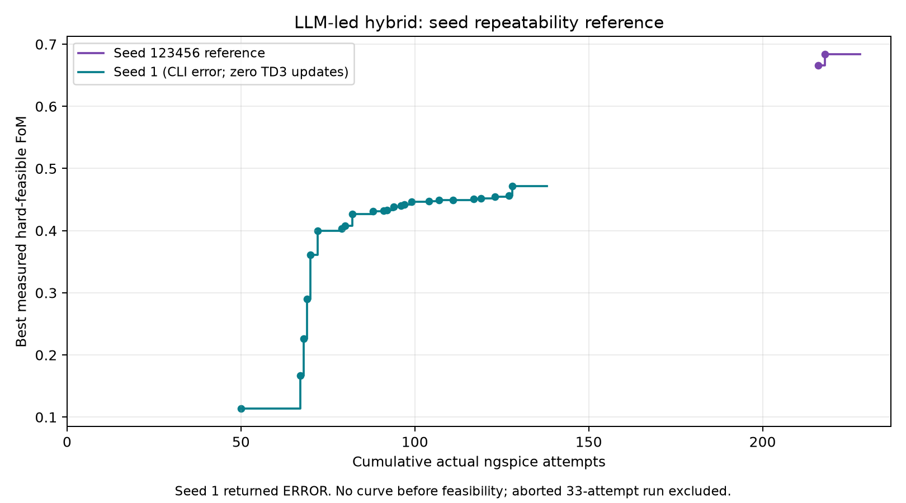
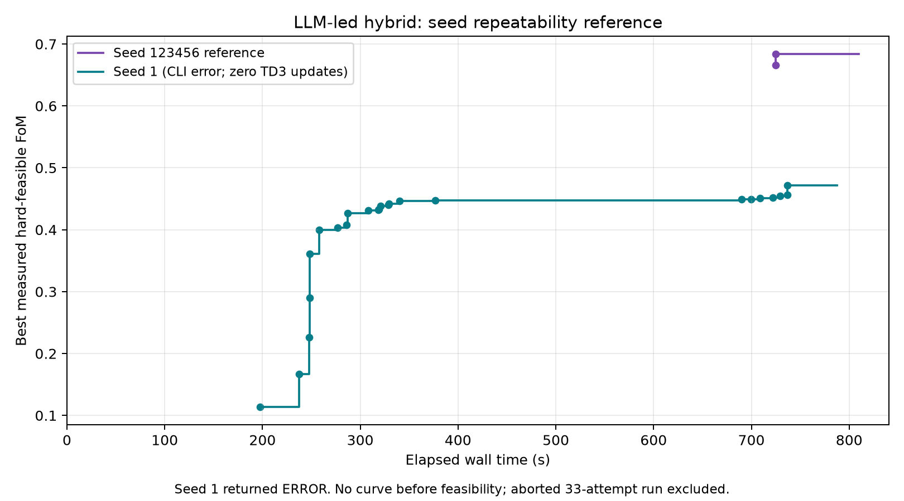

# Seed-1 LLM-led hybrid repeatability attempt

**Execution status: failed/incomplete.** The authorized fresh replacement measured
a best hard-feasible FoM of **0.4718492111853924** at simulation **128**, with first
feasibility at **50**, and used **138 actual ngspice attempts**. Antigravity returned
an API stream-idle error, so the unchanged validated launcher records
`success=false`, `incomplete=true`, `optimization_status=execution_failure` and
`stop_reason=execution_error`. This is not presented as a successfully completed
replication.

There were **zero TD3 training updates**. The observed search was random TD3 warmup
followed by LLM refinement, rather than the reference's learned-TD3-policy/LLM
cooperation. The result does not reproduce the reference FoM of 0.68378588 and does
not test repeatability of TD3 learning across seeds.

## Configuration and preservation

Run ID: `hybrid_66lc7o6_`, using the unmodified working implementation on
`integration/llm-led-validation`. Model: **`gemini-3.8-flash-high`**, inherited by
both native roles. TD3 seed: **1**. Resource ceilings: **300 simulator attempts,
30 warmup steps, 120 training steps, 130 LLM evaluations**.

```bash
python -B llm/run_experiment.py --strategy llm_led --model gemini-3.8-flash-high --budget 300 --warmup-steps 30 --train-steps 120 --llm-evaluations 130 --td3-config llm/configs/td3_seed1.json
```

`td3_seed1.json` was checked against the reference's saved settings: **only `seed`
differs**. The nominal initial design, numerical targets and grids also match.
The replacement began with an empty archive and an uninitialized TD3 agent/buffer.
It measured the supplied original circuit first; no optimized design, candidate
history or replay state was imported. The initial measurement again returned
reward −1.380930440660967.

No coordinator, specialist, skills, optimizer, replay logic, reward, constraint,
measurement, netlist, grid or learning hyperparameter file changed for the run.
The [preflight source/reference hashes](preflight.json) and [audit](audit.json)
confirm those files and the published reference remained unchanged. Existing
validation evidence is **55 tests passed, one optional real-MCP smoke skipped**;
the code was not changed and the optimization was not used as a test retry.

Local `CAD_AGY` and `NGSPICE_EXECUTABLE` environment overrides selected the existing
installed executables; the manifest records them with personal paths redacted in
this preserved copy. Original unredacted raw outputs remain locally under
`llm/runs/hybrid_66lc7o6_/`. This Windows execution environment differs from the
published reference's environment. Its historical LF setup hash and the local CRLF
hash differ, but the parsed targets/grids and circuit settings match. Timing and
small numerical differences cannot be attributed only to the random seed.

## Separate aborted launch and corrected routing

Before the replacement, an initial attempt (`hybrid_wgku3xao`) was stopped after
**33 simulations** because the effective Antigravity registration pointed at the
older `cad-git` backend. The first preflight checked only the local registration
file and missed this effective global registration. That was a launch/preflight
error; it is not hidden or included in the replacement's scientific trajectory.

The effective registration was corrected to the validated checkout. A
[zero-budget MCP check](backend_route_check.json), without a model call, confirmed
seed 1 and the correct ceiling-based LLM-led protocol with zero extra simulations.
The user then explicitly authorized **one fresh replacement**. Its first live
`get_problem` again confirmed the correct protocol and empty TD3 state.

The aborted attempt's candidates/replay were not reused. Its accounting is in
[the abort report](../../llm/reports/SEED1_ABORTED.md). Total simulator work across
the two authorized attempts was **171 = 33 aborted + 138 replacement**. The plots
below compare only the replacement with the reference; the 33 aborted attempts
remain separately disclosed overhead. No third attempt or automatic retry was run.

## Actual attempts and execution outcome

| Item | Measured replacement |
|---|---:|
| Actual ngspice attempts / cap | 138 / 300 |
| Successful process return codes | 138 |
| Simulator failures | 0 |
| LLM measurements | 105 |
| Random warmup steps | 30 |
| Reset evaluations | 3 |
| TD3 training steps / critic / actor updates | 0 / 0 / 0 |
| Archive candidates | 135 |
| Hard-feasible archive candidates | 41 |
| Repeated measured parameter vectors | 0 |
| Invalid off-grid parameter requests | 1, zero simulator attempts |
| Total wall time | 787.864 s |
| Simulator subprocess time | 35.76060409913771 s |
| CLI exit code / result status | 0 / ERROR |

The actual process log is complete and contiguous from 1 to 138. Nested probe
entries are not added to individual simulator entries. The off-grid request
`wn1=700nm` was rejected (the width step is 250nm); its outer batch also reports the
same rejection, not another simulator failure. No resource ceiling was exceeded.
Unused capacity was 162 simulator attempts, 25 LLM attempts and all 120 training
steps. It was not silently converted into further runs or a larger budget.

The retained error is:

```text
API error (attempt 1): request failed: stream idle timeout (5m0s): context deadline exceeded
```

The final prose claims completion, and the measured archive does contain ten
non-improving candidates after its best. That satisfies the numerical stagnation
predicate, but **does not override the CLI's ERROR status**. The validated protocol
therefore correctly preserves execution failure. Its 15-minute overall print
timeout and the API's stream-idle behavior were not changed.

## First feasible and best measured designs

First feasible: **`design_04db26ca58904b4f89c9300eddda89e1`**, global simulation
**50**, elapsed **197.5650186999701 s**, FoM **0.11333446684596657**, source
**TD3 random warmup**, not policy learning. It was found in the single warmup call
after 30 initial LLM simulations. Full record: [first_feasible_design.json](first_feasible_design.json).

Best measured: **`design_c132717b292d4b14a3e5e7c7d0ea1e6d`**, global simulation
**128**, elapsed **736.6854189999867 s**, source **LLM**, FoM
**0.4718492111853924**. Its direct parent is
`design_c97cd0f390214ff3bad49b13c3b4f5fd` at simulation 123; the only direct change
was `wn4: 3e-6 -> 2.75e-6 m`. The full ancestor chain ends at the warmup candidate
from simulation 50. **No TD3 policy-generated ancestor exists in this run.**

| Specification | Best measured | Hard constraint |
|---|---:|---|
| Gain (V/V) | 760.874210005078 | ≥200 |
| Integrated noise (V RMS) | 0.027061113 | ≤0.03 |
| Phase margin (deg) | 60.701310048951996 | ≥60 |
| Rising slew (V/µs) | 65.49168587979177 | ≥30 |
| UGBW (Hz) | 106641936.39375883 | ≥100000000 |
| Area (m²) | 5.753935119047619e-10 | optimization objective |
| Current (A) | 0.0004465289 | optimization objective |

All 20 parameters, using verified device roles:

| Device group | Multiplicity | Width (m) | Length (m) |
|---|---|---|---|
| NMOS input pair | `mn1=15` | `wn1=5e-7` | `ln1=1.35e-7` |
| PMOS mirror load | `mp1=9` | `wp1=2.75e-6` | `lp1=1.8e-7` |
| Shared diode-connected reference | `mn3=3` | `wn3=1.4999999999999998e-6` | `ln3=1.8e-7` |
| Input tail-current mirror | `mn4=9` | `wn4=2.75e-6` | `ln4=1.35e-7` |
| Second-stage PMOS amplifier | `mp3=10` | `wp3=2e-6` | `lp3=9e-8` |
| Second-stage sink | `mn5=8` | `wn5=2.5e-6` | `ln5=1.35e-7` |

Compensation: **`cap=1e-12 F`, `res=2500 Ω`**. The exact record is
[best_feasible_design.json](best_feasible_design.json). Nominal PM margin is only
0.701310048951996°, so this is not a robustness/PVT claim.

## Trajectory and physical decisions





The curves use actual cumulative process indices and the existing efficiency
summarization. They are undefined before feasibility, stop at each observed end,
and do not extrapolate seed 1 to the reference's 228 attempts. Source-specific
milestones are retained in [measurement_summary.json](measurement_summary.json).
The [Pareto plot](pareto.png), [Solutions export](Solutions/solutions.csv),
[all measured vectors](measurements.csv), parent IDs and hypotheses are preserved.

The first 30 LLM measurements improved the initial slew/UGBW deficits but did not
find feasibility. The agent then chose the one 30-step random warmup. That warmup
provided the feasible base at 50. It also initialized replay with the prior 30 LLM
records and added 30 random transitions, but **training was never called**. Replay
availability alone did not produce learning updates.

LLM refinement of the random base reduced compensation from 2.8pF toward 1pF,
traded phase-margin reserve for reduced area/speed, tuned the nulling resistor, and
trimmed input/tail sizing. The feasible best rose through 0.361197 (70), 0.399295
(72), 0.427147 (82), 0.446632 (99), 0.454153 (123) and 0.471849 (128). Many later
improvements were tiny one-grid-step refinements. Noise- and phase-margin failures
bounded several narrower input/tail/reference probes. Ten subsequent candidates
did not improve the last best.

One specialist was invoked and received two follow-up messages; the coordinator
had 37 public response steps and four candidate retrievals. The long interval
between simulations 106 and 107 is consistent with the reported five-minute
stream-idle problem. Pure inference time is not independently measured. Full
public events, call arguments and final model prose are retained.

Remaining reasoning limitations were not repaired during the experiment. The
specialist initially called `mn5` the tail device; the later final answer called
it the reference diode. Both are wrong: `mn4` is the tail mirror, `mn3` the shared
reference and `mn5` the output sink. Approximate sensitivity predictions and
claims of a local Pareto optimum or simultaneously binding constraints are not
established by these measurements. The prose also writes nano-scaled square
metres as `nm²`; the best area is correctly **575.3935119047619 µm²**. This report
uses archive measurements rather than those labels or unsupported explanations.

## Descriptive comparison with seed 123456

| Metric | Seed 123456 reference | Seed 1 replacement |
|---|---:|---:|
| Execution status | SUCCESS | ERROR; incomplete |
| Actual attempts | 228 | 138 |
| First feasible attempt | 216 | 50 |
| Best feasible FoM | 0.6837858803353272 | 0.4718492111853924 |
| Attempt of best | 218 | 128 |
| LLM evaluations | 63 | 105 |
| Warmup steps | 30 | 30 |
| Training steps / critic updates | 120 / 120 | 0 / 0 |
| Reset attempts | 15 | 3 |
| Best candidate origin | LLM refinement of TD3 policy | LLM refinement of random warmup |
| Wall seconds | 810.047 | 787.864 |
| Simulator subprocess seconds | 10.914981962025195 | 35.76060409913771 |
| CLI total tokens | 371514 | 225230 |

The best measured seed-1 FoM is **0.21193666914993475 lower**, about **30.99% below**
the reference. It found a feasible design earlier but did not reproduce a similarly
strong measured score. Its lower attempt count partly reflects no policy training,
and its ERROR status prevents treating it as a clean successful replication.
This neither proves seed 1 is worse nor establishes any statistical significance.

Only the TD3 seed changed in the numerical settings. Nevertheless, stochastic LLM
choices changed allocations substantially, the reference predates the validated
protocol/reporting corrections, and the execution environments differ. There is
no causal seed-isolation or runtime-speedup claim. In particular, because this run
has **zero updates**, it cannot validate robustness of the reference's trained TD3
contribution. It demonstrates only measured random-warmup/LLM cooperation under
the replacement's executed trajectory.

Original replacement usage fields:

```json
{"input_tokens":176625,"output_tokens":48605,"thinking_tokens":33809,"cache_read_tokens":2294397,"total_tokens":225230}
```

Cache reads and thinking are not added again to the reported input-plus-output
total. The aborted attempt's model usage was not recovered. Total-turn model cost
therefore cannot be compared from the replacement's token number alone.

## Outcome and next step

No validated-source change, extra seed, fallback model, budget increase, automatic
retry, commit or push was made. The first wrong-route attempt was stopped; exactly
one fresh replacement was then launched with explicit user authorization. It is
fully preserved as an **execution-failed attempt with valid measured candidates**,
not silently upgraded to SUCCESS because a final narrative or good circuit exists.

The repeatability question remains unresolved for trained TD3–LLM cooperation.
Any further attempt needs separate authorization and should first resolve/check
native service reliability while preserving the frozen experiment configuration.
Do not infer a seed effect from this single incomplete, differently allocated run.

Evidence: [summary](summary.json), [manifest](manifest.json), [audit](audit.json),
[calls](calls.jsonl), [archive](candidates.jsonl), [comparison](comparison.json),
[public events](public_events.jsonl), [model response](model_response.md),
[preflight hashes](preflight.json), [zero-budget routing check](backend_route_check.json).
Personal paths are redacted in this preserved result bundle; numeric results,
IDs, provenance and source hashes are unchanged.
